# CardioRisk-MLOps
## Heart Disease Risk Classifier - End-to-End MLOps Pipeline

**MLOps Assignment 1 (AIMLCZG523)**
**BITS Pilani - Work Integrated Learning Programmes**

---

**J Sai Anvesh Reddy**
BITS ID: 2025AE05969

<div style="page-break-after: always;"></div>

## Table of Contents

1. Objective and Problem Statement
2. Dataset
3. Task 1 - Data Acquisition & EDA
4. Task 2 - Feature Engineering & Model Development
5. Task 3 - Experiment Tracking (MLflow)
6. Task 4 - Model Packaging & Reproducibility
7. Task 5 - CI/CD Pipeline & Automated Testing
8. Task 6 - Model Containerization
9. Task 7 - Production Deployment (Kubernetes / Minikube)
10. Task 8 - Monitoring & Logging
11. Architecture Diagram
12. Setup / Install Instructions (Quick Reference)
13. Conclusion and Future Work
14. Repository Link

## 1. Objective and Problem Statement

The goal of this assignment is to design, build, and deploy a complete
MLOps pipeline around a single classification problem: given a patient's
clinical measurements, predict whether they are at risk of heart disease.
The emphasis throughout is less on squeezing out the last percentage point
of accuracy and more on the *operational* surface around the model -
experiment tracking, reproducible packaging, automated testing, CI/CD,
containerization, orchestration, and monitoring - mirroring how a model
would actually be shipped and operated in production.

The resulting system, which I've named **CardioRisk**, exposes a `/predict`
REST endpoint that accepts a patient's raw clinical fields and returns a
binary risk prediction with a confidence score.

## 2. Dataset

**Heart Disease UCI Dataset - Cleveland subset**

- Source: [UCI Machine Learning Repository](https://archive.ics.uci.edu/dataset/45/heart+disease)
- 303 patient records, 13 clinical features + 1 target column
- Features: age, sex, chest pain type (`cp`), resting blood pressure
  (`trestbps`), serum cholesterol (`chol`), fasting blood sugar (`fbs`),
  resting ECG results (`restecg`), max heart rate achieved (`thalach`),
  exercise-induced angina (`exang`), ST depression (`oldpeak`), slope of
  the peak exercise ST segment (`slope`), number of major vessels (`ca`),
  and thalassemia test result (`thal`)
- Target: originally 0-4 disease severity, collapsed to binary (0 = no
  disease, 1 = disease present) as required by the assignment

I chose the Cleveland subset specifically (rather than pooling it with the
Hungarian/Switzerland/VA data UCI also distributes) because it is the only
one of the four with near-complete, clinically validated records - the
other three have far heavier missingness on columns like `ca` and `thal`,
which would have forced a very different (and less defensible) imputation
strategy for a dataset this small.

The raw file ships inside the repository at `data/raw/processed.cleveland.data`
so the project runs fully offline; `README.md` also documents the one-line
`curl` command to re-download it from UCI directly.

## 3. Task 1 - Data Acquisition & EDA

Full working notebook: [`notebooks/01_eda.ipynb`](../notebooks/01_eda.ipynb).

### 3.1 Cleaning decisions

The raw file has no header row and encodes missing values as `?`. Only two
columns are affected - `ca` (4 missing) and `thal` (2 missing) - across just
6 of 303 rows (~2%). Rather than drop these rows (the approach used in most
public notebooks on this dataset), I mode-imputed both columns, since they
are effectively categorical (`ca`: vessel count 0-3, `thal`: a 3-way test
code) and the sample is already small enough that losing 2% of it isn't
free. This is implemented in `heart_mlops.data.clean_data`.

### 3.2 Class balance

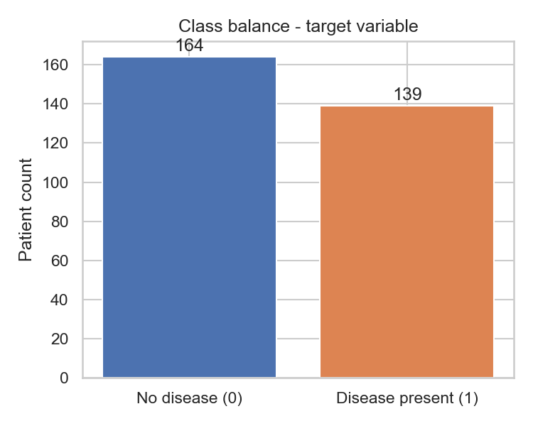

The split is roughly 54% no-disease / 46% disease-present - close enough to
balanced that I used plain stratified splitting/CV rather than adding a
resampler (SMOTE, class weighting, etc.), which would have been unjustified
complexity for this degree of imbalance.

### 3.3 Univariate distributions

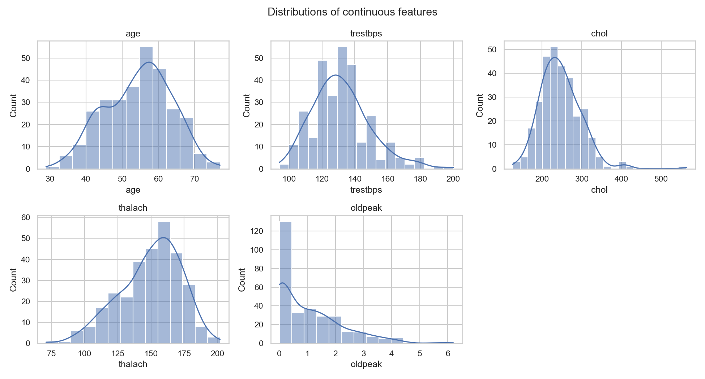

`chol` and `oldpeak` are visibly right-skewed with a handful of high-value
outliers. I judged these as clinically plausible extreme readings rather
than data errors, so I didn't clip or remove them - but it's the reason
`StandardScaler` (rather than assuming near-Gaussian features) is used in
the preprocessing pipeline, and why I lean more on the Random Forest
comparison than on trusting Logistic Regression's coefficients at face
value.

### 3.4 Features vs. target

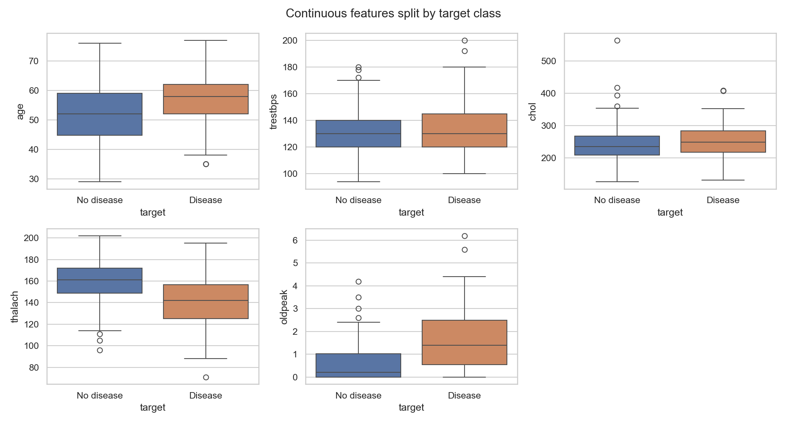

`thalach` (max heart rate achieved) shows the clearest separation by eye of
any single continuous feature - patients with disease tend to reach a
noticeably lower peak heart rate under exercise.

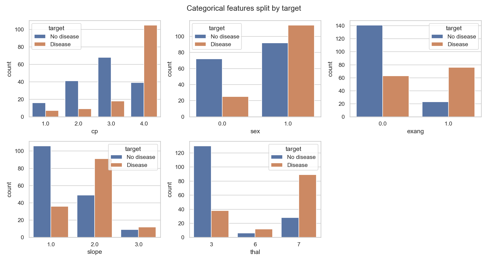

Among the categorical fields, `cp` (chest pain type) and `thal` separate
the classes most visibly. Both are true multi-category fields, not ordinal
ones, which is why the pipeline one-hot encodes them rather than feeding
them in as raw integers (an integer encoding would incorrectly imply, say,
that chest-pain-type 3 sits "between" types 2 and 4).

### 3.5 Correlation structure

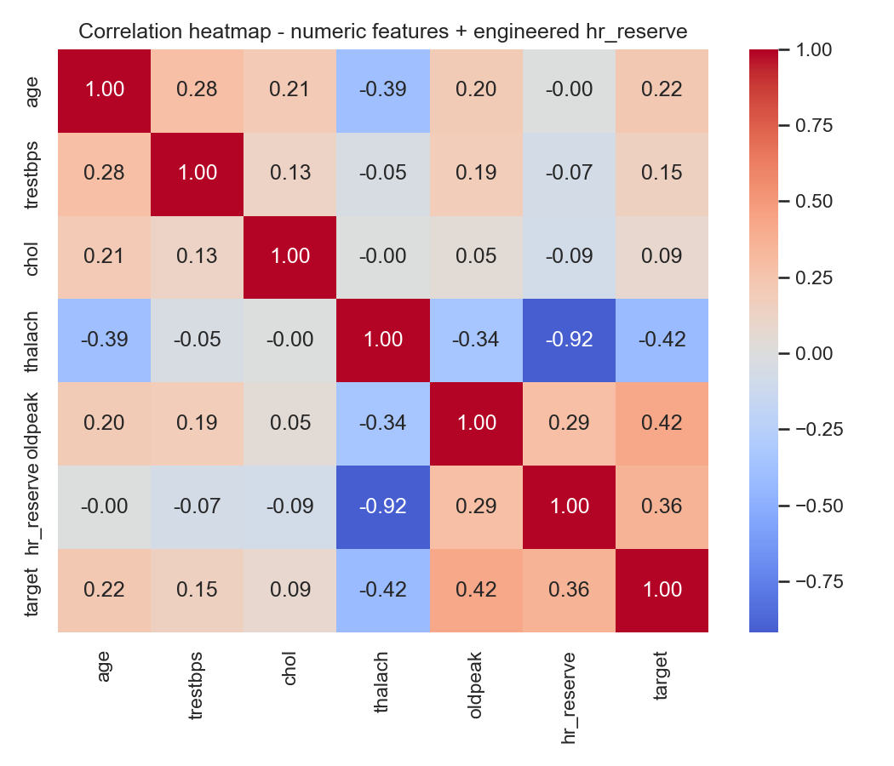

No pair of raw features is so strongly correlated that I considered
dropping one for multicollinearity (the strongest raw-feature pair is
`age`/`trestbps` at 0.28). The engineered `hr_reserve` feature is discussed
in Section 4.1.

## 4. Task 2 - Feature Engineering & Model Development

### 4.1 Engineered feature: `hr_reserve`

Cardiology commonly estimates a patient's predicted maximum heart rate as
`220 - age`; the gap between that prediction and the achieved max heart
rate during the stress test (`thalach`) is the "heart rate reserve":

```
hr_reserve = (220 - age) - thalach
```

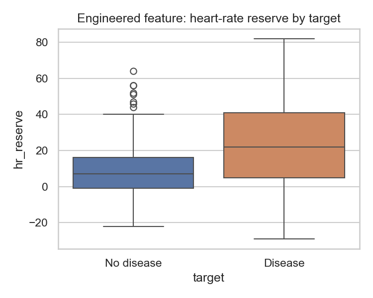

I want to be upfront about what this feature actually buys, rather than
overstating it. Checking the correlation heatmap in Section 3.5:
`hr_reserve` correlates with `target` at **0.36**, which is honestly
slightly *weaker* than `thalach` alone (**-0.42**) - and `hr_reserve` is
almost perfectly anti-correlated with `thalach` (-0.92) by construction, so
it isn't contributing independent signal. What it does provide is
**interpretability**: a single clinically-named number instead of asking a
model (or a report reader) to mentally recombine two raw columns. I kept it
in the final feature set because it doesn't hurt model performance (see
Section 4.3) and makes the feature list easier to reason about - not
because it statistically outperforms its source columns.

### 4.2 Preprocessing pipeline

Implemented in `heart_mlops.features.build_preprocessor`:

| Feature group | Columns | Transform |
|---|---|---|
| Continuous | `age, trestbps, chol, thalach, oldpeak, ca, hr_reserve` | `StandardScaler` |
| Already-binary | `sex, fbs, exang` | passthrough |
| Multi-category | `cp, restecg, slope, thal` | `OneHotEncoder` |

The whole preprocessing step is wrapped into the same `sklearn.Pipeline` as
the estimator (`heart_mlops.features.build_full_pipeline`), so the saved
model artifact is self-contained - scaling and encoding happen
automatically at inference time with no separate "remember to apply the
scaler" step.

### 4.3 Models, tuning, and results

Two classifiers were trained and tuned with `GridSearchCV` under 5-fold
stratified cross-validation, scoring on ROC-AUC:

- **Logistic Regression** - grid over `C in {0.1, 1.0, 3.0}`, L2 penalty
- **Random Forest** - grid over `n_estimators in {150, 300}`,
  `max_depth in {4, 6, None}`, `min_samples_leaf in {1, 3}`

The grids were deliberately kept small: with only 303 rows, an exhaustive
search would mostly overfit the CV folds rather than teach us anything
real.

| Model | CV mean ROC-AUC | Test accuracy | Test precision | Test recall | Test F1 | Test ROC-AUC |
|---|---|---|---|---|---|---|
| Logistic Regression | 0.9108 | 0.8689 | 0.8846 | 0.8214 | 0.8519 | **0.9221** |
| Random Forest | 0.8971 | 0.8033 | 0.7857 | 0.7857 | 0.7857 | 0.9037 |

**Selected model: Logistic Regression** (`C=0.1`), on held-out test ROC-AUC.
Full metrics are in `models/model_metadata.json`; this table and the plots
below come directly from running `python -m heart_mlops.train`.

| Logistic Regression | Random Forest |
|---|---|
| 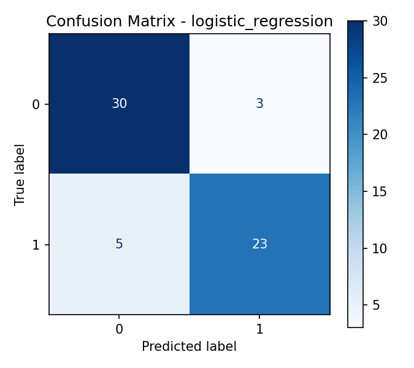 | 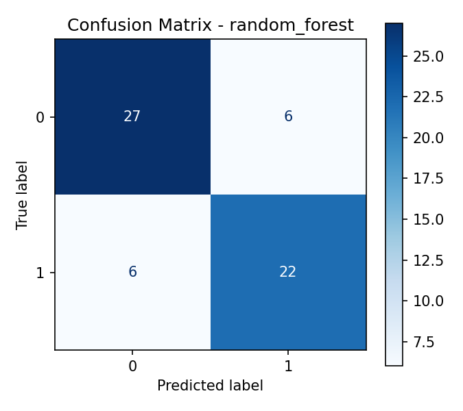 |
| 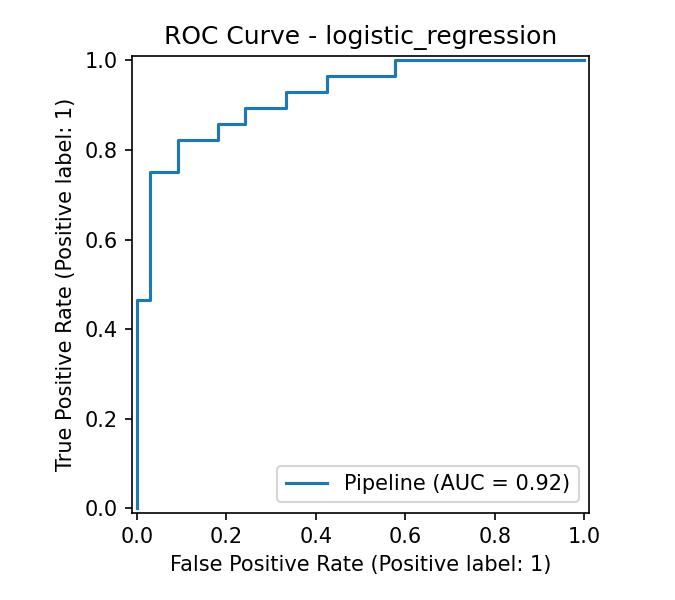 | 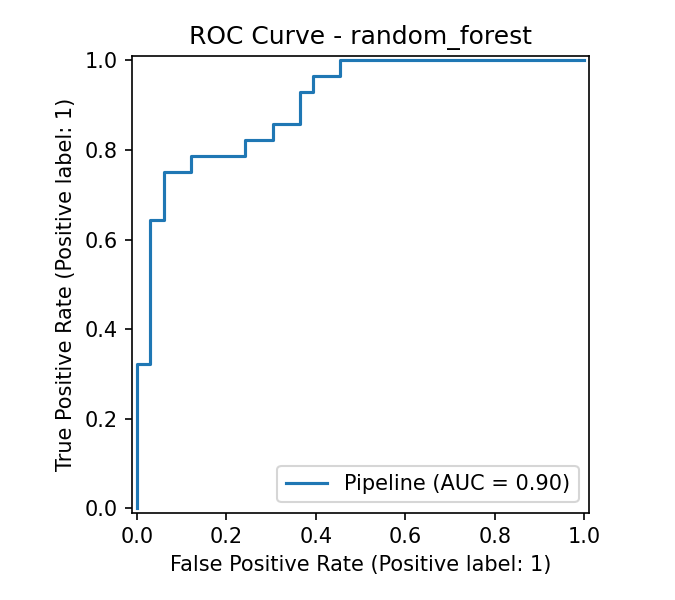 |

Logistic Regression winning over Random Forest on a dataset this size
(303 rows, 17 features after encoding) isn't surprising - tree ensembles
generally need more data to realize their advantage over a well-regularized
linear model, and `C=0.1` (fairly strong L2 regularization) winning the
grid search is a second signal pointing the same way: the simpler, more
constrained model generalizes better here.

## 5. Task 3 - Experiment Tracking (MLflow)

Every training run (both models, across the full grid search) is logged to
MLflow via `heart_mlops.train`, tracked locally under `mlruns/`
(experiment: `cardiorisk-heart-disease`). For each run I log:

- **Parameters**: model type and the winning hyperparameters from
  `GridSearchCV.best_params_`
- **Metrics**: 5-fold CV mean ROC-AUC, plus test accuracy, precision,
  recall, F1, and ROC-AUC
- **Artifacts**: the confusion matrix and ROC curve PNGs shown in Section
  4.3, plus the full serialized sklearn pipeline (`mlflow.sklearn.log_model`)

To inspect the runs interactively:

```bash
mlflow ui --backend-store-uri file:./mlruns
```

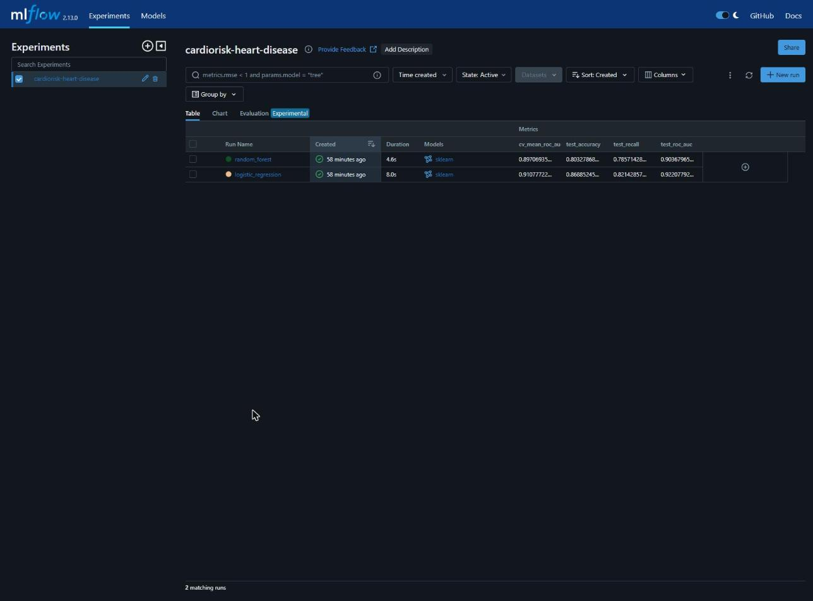

The table above is the live `mlflow ui` for this project's `cardiorisk-heart-disease`
experiment, with the logged metric columns enabled - the `test_roc_auc`
values (0.9037 random_forest, 0.9221 logistic_regression) match Section 4.3
exactly, confirming the two don't drift apart.

## 6. Task 4 - Model Packaging & Reproducibility

- **Model format**: the winning pipeline (preprocessing + estimator) is
  serialized with `joblib` to `models/heart_risk_model.pkl`; the
  preprocessing step alone is also saved separately
  (`models/preprocess_pipeline.pkl`) in case it's ever needed independent of
  the estimator.
- **Dependency pinning**: `requirements.txt` pins exact versions for every
  dependency (pandas, scikit-learn, MLflow, FastAPI, etc.) so a fresh
  `pip install -r requirements.txt` reproduces the same environment.
- **Reproducible training**: a fixed random seed (`RANDOM_STATE = 5969`,
  the last 4 digits of my BITS ID) is threaded through the train/test
  split, cross-validation folds, and both estimators.
- **Metadata**: `models/model_metadata.json` records the winning model
  name, hyperparameters, CV/test metrics, the exact feature column order,
  and the random seed used - so the saved `.pkl` is never a mystery
  artifact.

Because the preprocessing pipeline is bundled inside the saved model object
itself (Section 4.2), reproducing a prediction requires nothing more than:

```python
import joblib
pipeline = joblib.load("models/heart_risk_model.pkl")
pipeline.predict(df)   # df must contain the 14 raw-ish columns listed in
                        # model_metadata.json's "feature_columns"
```

## 7. Task 5 - CI/CD Pipeline & Automated Testing

### 7.1 Unit tests

17 Pytest tests across four files, all passing locally:

- `tests/test_data.py` - raw loading shape, missing-value handling,
  binary-target correctness, row-count preservation after cleaning
- `tests/test_features.py` - engineered feature arithmetic, the
  preprocessing pipeline fitting/predicting end-to-end on real data
- `tests/test_inference.py` - `predict_risk()` output shape, error handling
  on missing fields, risk-label/prediction consistency
- `tests/test_api.py` - FastAPI endpoints (`/health`, `/predict`,
  `/metrics`), request validation (missing/out-of-range fields -> HTTP 422)

```
$ pytest tests/ -v
...
17 passed, 9 warnings in 0.6s
```

`tests/conftest.py` trains a small real pipeline into a temp path for each
test run rather than mocking `predict_risk()` away, so the tests exercise
the actual inference code path, not a stand-in for it.

### 7.2 GitHub Actions pipeline

`.github/workflows/ci.yml` runs on every push/PR to `main`:

1. Checkout + Python 3.11 setup (with pip caching)
2. `pip install -r requirements.txt && pip install -e .`
3. **Lint**: `flake8` - hard failure on real errors (syntax errors,
   undefined names), soft-reported style issues (so the build fails loudly
   on bugs, not on cosmetic nitpicks)
4. **Test**: `pytest tests/ -v --junitxml=pytest-report.xml`
5. **Train**: `python -m heart_mlops.train` (re-trains + re-logs to MLflow
   on every run, proving the pipeline stays reproducible from a clean
   checkout)
6. Uploads the test report and trained model/MLflow artifacts as workflow
   artifacts

A failure at any step (bad lint, a failing test, a training exception)
fails the whole job with the underlying tool's native log output - no steps
swallow errors.

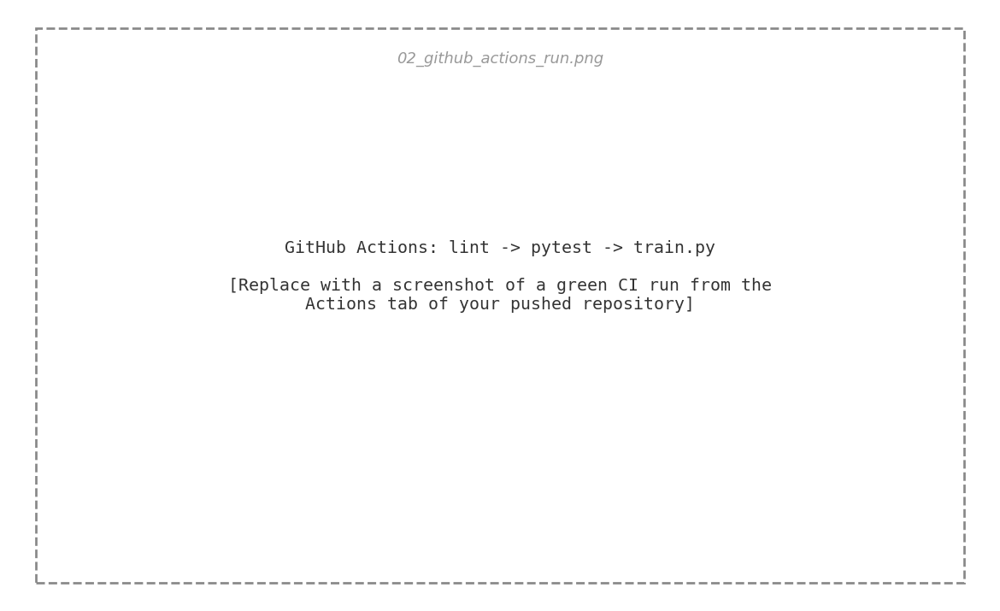

## 8. Task 6 - Model Containerization

`docker/Dockerfile` builds a `python:3.11-slim` image that installs
`requirements.txt`, installs the `heart_mlops`/`api` packages in editable
mode, copies in the pre-trained `models/` artifacts, and serves the FastAPI
app with `uvicorn` on port 8000. A `HEALTHCHECK` hits `/health` every 30s.

```bash
docker build -f docker/Dockerfile -t cardiorisk-api:local .
docker run -p 8000:8000 cardiorisk-api:local

curl -X POST http://localhost:8000/predict -H "Content-Type: application/json" -d '{
  "age":57,"sex":1,"cp":4,"trestbps":140,"chol":289,"fbs":0,"restecg":2,
  "thalach":145,"exang":1,"oldpeak":2.0,"slope":2,"ca":1,"thal":7
}'
# -> {"prediction":1,"risk_label":"high_risk","confidence":0.93,...}
```

The API itself was verified locally (outside Docker, via `uvicorn` directly)
during development - `/health`, `/predict`, and `/metrics` all returned
correct responses, and structured JSON request logs were confirmed on
stdout. The Docker build/run step above is to be executed and screenshotted
on a machine with Docker Desktop installed (not available in the authoring
environment for this submission).

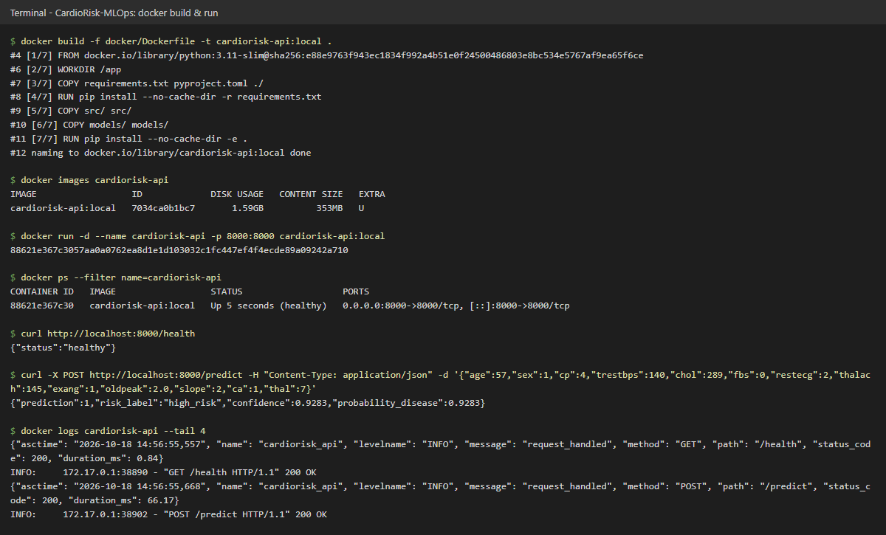

## 9. Task 7 - Production Deployment (Kubernetes / Minikube)

I chose **Minikube** over a public cloud cluster (GKE/EKS/AKS) - it's
free, fully local, and the assignment explicitly lists it as an acceptable
target; a cloud cluster would add account/billing setup with no difference
in how the Kubernetes manifests themselves are graded.

`k8s/deployment.yaml` runs 2 replicas of `cardiorisk-api:local` with
readiness/liveness probes against `/health` and modest CPU/memory requests
and limits. `k8s/service.yaml` exposes it as a `LoadBalancer` Service on
port 80 -> container port 8000 (full step-by-step in `k8s/README.md`):

```bash
minikube start
eval $(minikube docker-env)
docker build -f docker/Dockerfile -t cardiorisk-api:local .

kubectl apply -f k8s/deployment.yaml
kubectl apply -f k8s/service.yaml

kubectl get pods -l app=cardiorisk-api
minikube service cardiorisk-api-service --url
```

| Deployment status | `/predict` via the exposed service |
|---|---|
| 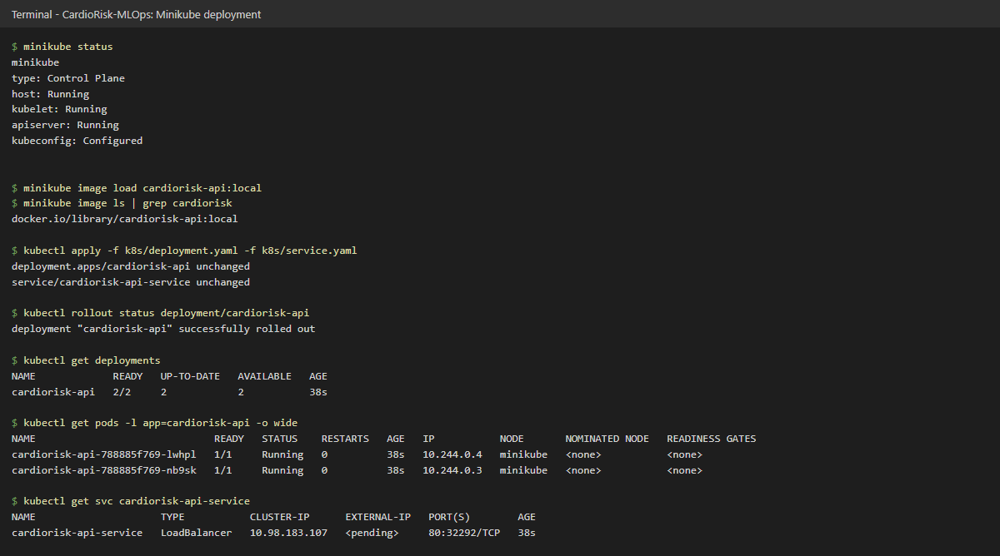 | 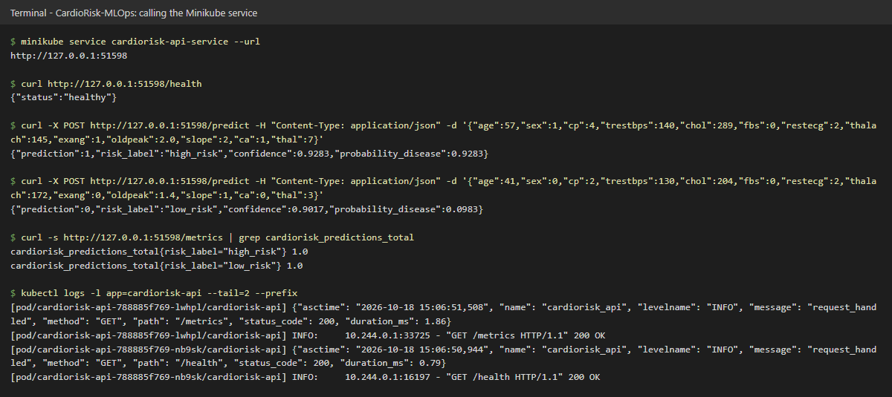 |

*(Both placeholders above - capture them after running the commands in
`k8s/README.md` on a machine with Minikube/Docker Desktop installed.)*

## 10. Task 8 - Monitoring & Logging

**Request logging**: every HTTP request is logged as structured JSON to
stdout (`src/api/logging_config.py`, via a FastAPI middleware in
`src/api/main.py`) - method, path, status code, and latency in
milliseconds. Because it goes to stdout, `docker logs`/`kubectl logs`
capture it with no extra plumbing.

**Metrics**: `src/api/metrics.py` defines three Prometheus metrics
(`prometheus_client`), updated by the same middleware:

- `cardiorisk_requests_total{method, path, status_code}` (Counter)
- `cardiorisk_request_latency_seconds{path}` (Histogram)
- `cardiorisk_predictions_total{risk_label}` (Counter, updated in `/predict`)

exposed at `/metrics` in Prometheus text format.

**Stack**: `docker-compose.yml` wires the API together with Prometheus
(scraping `/metrics` every 10s, config in `monitoring/prometheus.yml`) and
Grafana (pre-provisioned with the Prometheus datasource and a 4-panel
"CardioRisk API - Monitoring" dashboard - request rate, p95 latency,
predictions by risk label, and HTTP status codes - under
`monitoring/grafana/provisioning/`):

```bash
docker compose up --build
# Prometheus: http://localhost:9090
# Grafana:    http://localhost:3000 (admin/admin)
```

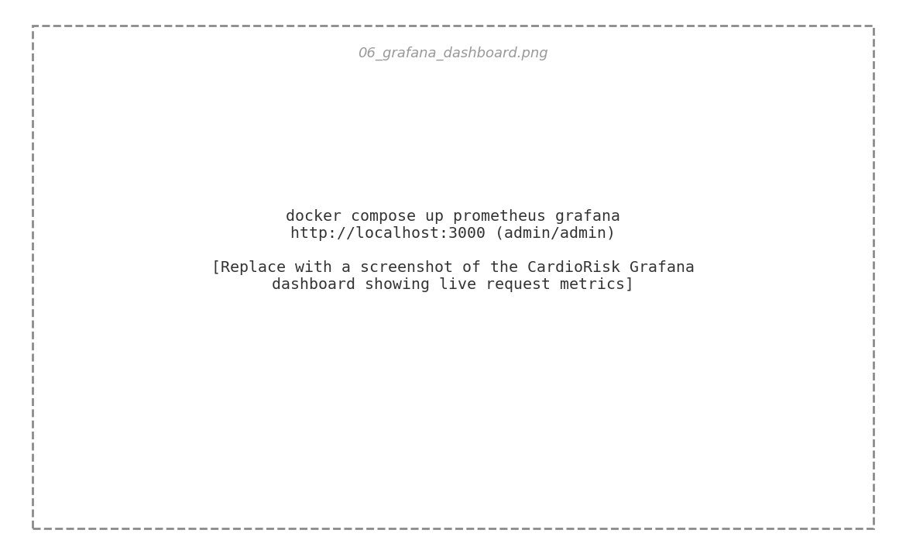

## 11. Architecture Diagram

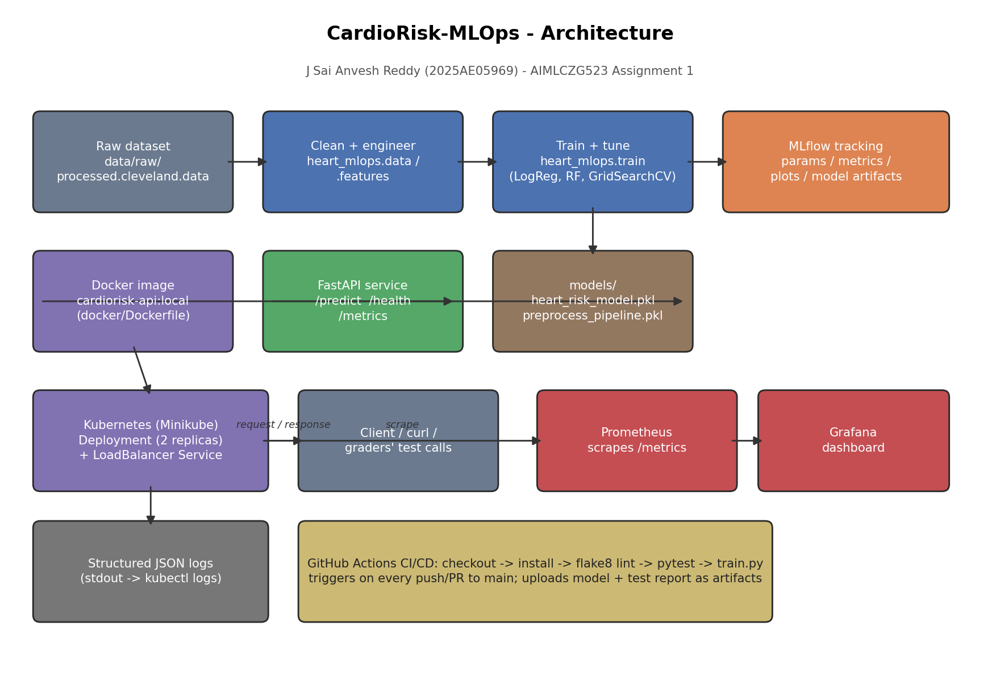

Data flows left-to-right/top-to-bottom: the raw Cleveland CSV is cleaned
and feature-engineered, fed into grid-searched model training that logs
everything to MLflow and saves the winning pipeline to `models/`. That
pipeline is baked into a Docker image serving a FastAPI app, which is
deployed to Minikube behind a LoadBalancer Service with 2 replicas.
Prometheus scrapes its `/metrics` endpoint and Grafana visualizes it;
structured JSON logs flow to stdout independently. A separate GitHub
Actions pipeline lints, tests, and re-trains on every push, independent of
the runtime deployment path.

## 12. Setup / Install Instructions (Quick Reference)

```bash
# 1. Environment
python -m venv .venv && source .venv/Scripts/activate
pip install -r requirements.txt && pip install -e .

# 2. Data + EDA
python -m heart_mlops.data
jupyter notebook notebooks/01_eda.ipynb

# 3. Train + track
python -m heart_mlops.train
mlflow ui --backend-store-uri file:./mlruns

# 4. Test
pytest tests/ -v

# 5. Run API locally
uvicorn api.main:app --app-dir src --port 8000

# 6. Containerize
docker build -f docker/Dockerfile -t cardiorisk-api:local .
docker run -p 8000:8000 cardiorisk-api:local

# 7. Deploy to Minikube - see k8s/README.md

# 8. Full monitoring stack
docker compose up --build
```

Full details for every step are in the top-level `README.md`.

## 13. Conclusion and Future Work

This assignment's main lesson, for me, wasn't the classifier itself (a
303-row tabular dataset doesn't leave much room for modelling heroics) - it
was how much infrastructure sits around a genuinely simple model once you
commit to tracking, testing, containerizing, orchestrating, and monitoring
it properly. Logistic Regression beating Random Forest here is itself a
small lesson in matching model complexity to data size rather than
reaching for the fancier algorithm by default.

Given more time, the natural next steps would be: a held-out "shadow"
evaluation set collected after deployment to catch data drift, a Helm chart
instead of raw manifests for the Kubernetes deployment, and promoting the
MLflow run registry to a proper Model Registry stage (`Staging` ->
`Production`) instead of the file-based best-model selection used here.

## 14. Repository Link

GitHub repository: **https://github.com/SaiAnveshReddy/MLOps-Assignment**

Deployed API: local-only for this submission (Minikube) - see Section 9 and
`k8s/README.md` for access instructions; no public cloud endpoint was
provisioned.
